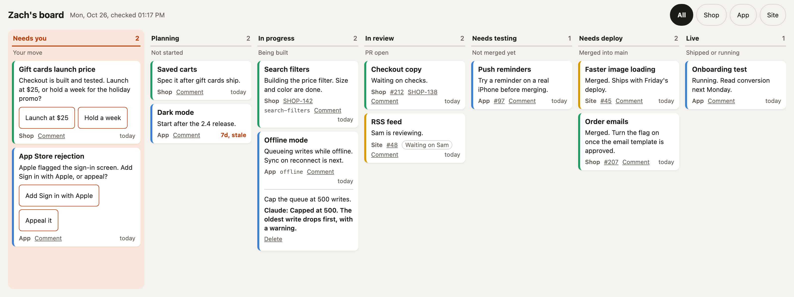

# yourmove

**A board your coding agents keep for you.**



You run five Claude Code sessions across five worktrees. By Thursday you no longer know which
PR is waiting on checks, which build is stuck in review, and which session has been waiting
two days for an answer from you. yourmove is a kanban board that the sessions keep true
themselves, so you can see where all your work stands without asking anyone.

Most agent boards work the other way: you make a card and the tool dispatches an agent to it.
yourmove leaves that to you. It is the report the agents write back.

- **Every card names its next move.** Seven columns, and a card sits in the one that says whose move it is.
- **Needs you gives you the exact words.** A card waiting on you says what to answer, and offers the answers as buttons. One press reaches the session as your reply.
- **Comments reach the right session.** Write on a card and your note arrives in the session working in that card's worktree, the next time you talk to it.
- **Sessions start briefed.** A new session is told its card, the work in flight around it, and your rules before you type a word.
- **Drift gets caught.** If a turn makes commits, opens a PR or merges one and the card does not move, the session is stopped once and asked to fix it.
- **PR states keep themselves.** The server reads GitHub and moves the cards whose PRs merged.
- **Almost no infrastructure.** One JSON Lines file, one HTML page and the Python standard library. No account, no database, no build.

## The columns

| State | Means |
| --- | --- |
| `needs-you` | The next move is yours: a decision, a merge, an approval, a verdict. |
| `planning` | Planned and not started. |
| `in-progress` | A session is building it. |
| `in-review` | A PR is open, waiting on review or checks. |
| `needs-testing` | Not merged. It has to be tried on a device before it can merge. |
| `needs-deploy` | Merged into main. Waiting on a deploy, a build, a store review or a switch. |
| `live` | In users' hands, or a test that is running. |

The columns are fixed on purpose. "Merged means `needs-deploy`, no exceptions" is what stops
an agent from guessing at state, and a board where every team renames its columns cannot
teach agents a rule like that.

## Install

You need Python 3.9 or newer and git. Syncing PR states also needs the [GitHub CLI](https://cli.github.com).

**Claude Code** (the plugin brings the hooks, the skill that teaches the rules, and the `yourmove` command):

```sh
claude plugin marketplace add zachbresler21/yourmove
claude plugin install yourmove@yourmove
```

**Make a board.** A board lives in a `.yourmove/` folder. Sessions find the nearest one above
their working directory, the way git finds `.git`. Put it at the root of one repo, or in a
folder above all your repos for one board across all of them:

```sh
cd ~/code && yourmove init     # writes .yourmove/yourmove.json with this repo as a project, and trusts it
yourmove trust                 # instead of init, for a board that already exists
yourmove serve                 # serves the board on http://127.0.0.1:47600/
yourmove open                  # opens it in your browser, with the link that lets the page in
yourmove autostart             # macOS: serve it from login on, instead of serve
```

Then list your projects in `.yourmove/yourmove.json`:

```json
{
  "owner": "Zach",
  "projects": {
    "shop": { "name": "Shop", "color": "#1f9d63", "repo": "acme/shop" },
    "blog": { "name": "Blog", "color": "#3b82d6", "repo": "acme/blog" }
  }
}
```

`repo` is the GitHub `owner/name`. It links PR numbers, and it is how a session knows which
projects its repo holds.

**Other agents** (Codex, Cursor, Aider): install the command with
`uv tool install git+https://github.com/zachbresler21/yourmove` (or the same with `pipx install`), and paste the body of
[`skills/yourmove/SKILL.md`](skills/yourmove/SKILL.md) into your `AGENTS.md`. You get the board,
the rules and the CLI. The briefing, comments and drift checks need an agent that runs hooks.

## How it works

### Cards

One card per line in `.yourmove/cards.jsonl`, so many sessions can edit at once without colliding:

```json
{"id": "shop-gift-cards", "project": "shop", "state": "needs-you", "title": "Gift cards", "next": "Pick a launch price.", "updated": "2026-10-20", "pr": 212, "where": "gift-cards", "choices": ["$10", "$25"]}
```

| Field | |
| --- | --- |
| `id` | Made from the project and title. Comments and the CLI use it. |
| `project` | A project key, or a list for work that spans several. |
| `state` | One of the seven columns. |
| `title` | The work, in a few words. |
| `next` | The next move, under 280 characters. On a `needs-you` card, the exact thing to say. |
| `updated` | The day someone last checked the card was true. Five days untouched shows as stale. |
| `pr`, `ticket`, `where`, `waiting`, `choices` | Optional: PR numbers, the team's ticket ID, the worktree folder, who it waits on, answers to offer. |

Order inside a column is the order in the file: most important first.

### The command

Agents keep the board through `yourmove`, which validates every write, stamps `updated`,
takes a lock, and rewrites only the line it changes:

```sh
yourmove add --project shop --title "Gift cards" --next "Spec the flow." --here
yourmove set shop-gift-cards --state in-review --pr 212 --next "Waiting on checks."
yourmove set shop-gift-cards --ticket SHOP-142     # its ticket in the team's tracker
yourmove set shop-gift-cards --state needs-you --next "Pick a launch price." --choice '$10' --choice '$25'
yourmove touch shop-gift-cards      # checked: still true
yourmove reply 3f9a1c2e "Priced at \$25 and shipped."
yourmove ls                         # the board, column by column
yourmove show shop-gift-cards       # one card, its choices and comments
yourmove rm shop-gift-cards         # dropped, or live for a week
yourmove lint                       # after a hand edit
yourmove sync                       # move cards whose PRs moved
yourmove log --days 7               # what moved this week
```

Editing `cards.jsonl` by hand is fine too. `yourmove lint` checks it, and the page names any
line it cannot show instead of dropping it silently.

### The hooks

| Hook | Does |
| --- | --- |
| `SessionStart` | Briefs the session: its card, other work in flight in its projects, your `RULES.md`, and any comments waiting for it. In the main worktree it also lists stale cards to check. |
| `UserPromptSubmit` | Hands the session any comment you wrote on its card since its last message. |
| `Stop` | Blocks the stop once if the turn moved the work and the board did not hear about it: commits with no card, a PR opened or merged, a card days unchecked, a comment with no reply. |

A session is matched to cards by its worktree folder's name (the card's `where`). A comment on
a card whose worktree is gone goes to the next session in that repo's main worktree.

Hooks stay silent in any repo the board does not list, so a board above all your repos costs
nothing in the ones it does not track.

### House rules

Put anything you want every session to know about your board in `.yourmove/RULES.md`, such as
"Only my own work gets a card. A teammate's PR never does." It is added to every briefing.

### Tickets

Your board is yours; your team probably tracks the same work in Linear or Jira. yourmove does not
sync with them, because they already sync with GitHub. Give a card its ticket with `--ticket SHOP-142`,
and the session is told to put `SHOP-142` in the branch name and PR title. Linear's GitHub integration
then links the PR and moves the ticket as the PR opens and merges (pick the states in the team's PR
automations). Jira's links the PR, and a Jira automation rule can move the ticket.

To make the ID a link on the page, add the tracker's issue URL to `yourmove.json`, with `{id}` where the ID goes:

```json
{ "tickets": "https://linear.app/acme/issue/{id}" }
```

### History

Every add, move and removal made through the command, or by sync, is appended to
`.yourmove/history.jsonl`. `yourmove log --days 7` answers "what moved this week" for a weekly review.

### Autostart and plugin updates

`yourmove autostart` writes a macOS LaunchAgent that runs this copy of yourmove. A plugin update
moves the plugin to a new folder, so the next session that starts points the LaunchAgent at the new
one and restarts the server.

## Security

A comment reaches your sessions as your own words, so four things guard who can write one.

- **Only boards you trust get a voice.** Any repo can ship a `.yourmove/` folder, and the plugin
  runs in every session. The hooks ignore a board until you trust it on your machine: `yourmove init`
  trusts the board it makes, and `yourmove trust` trusts one that already exists. The list is in
  `~/.config/yourmove/trusted-boards`, outside every repo.
- **Only your server can sign a comment.** The board server signs each comment with a key that
  lives in `~/.config/yourmove/comment-key`, readable by you alone. A comment that is unsigned or
  edited after signing is dropped, so a teammate who commits to a shared board's `comments.jsonl`
  cannot speak as you.
- **Only the board page can post.** The server listens on 127.0.0.1 only, checks `Host` to stop
  DNS rebinding, and checks `Origin` so another site cannot post from your browser.
- **Only you can reach the server.** Any program can fake those headers, so every request also needs
  a token from `~/.config/yourmove/server-token`, readable by you alone. That keeps the other accounts
  on a shared machine out. `yourmove open` hands the page the token through a file only you can read,
  never a command line, and the page keeps it. The token is never printed or logged.

One gap remains, as for any page on localhost: if another account takes the port while your server
is down, a page it serves there can read the kept token. On a shared machine, keep the server running
with `yourmove autostart` or your init system.

`RULES.md` goes into every session's context, so trust a board's `RULES.md` the way you trust a
repo's `CLAUDE.md`. Session state for the drift check lives in your home directory, never a
shared `/tmp`.

The board is plain text on disk, as private as the folder it is in. Keep secrets and user data
off it. Committing a board to a repo works: `yourmove init` writes a `.gitignore` that keeps the
server log and lock files out.

yourmove sends nothing anywhere. The only network calls are the `gh` commands that sync PR states.

Found a hole? Please report it privately: [SECURITY.md](SECURITY.md) says how.

## Limits

- One owner per board. The comment model assumes every comment is yours.
- GitHub only, for PR links and sync.
- Tested on macOS and Linux. Windows is untested.

## Development

```sh
PYTHONPATH=src python3 -m unittest discover -s tests -t tests
CHROME=/path/to/chrome tests/e2e/run.sh    # the page, server, hooks and CLI together; needs Node 22+
CHROME=/path/to/chrome docs/screenshot.sh  # remakes docs/board.png from a demo board
uvx ruff check src tests bin/yourmove && uvx ruff format --check src tests bin/yourmove
uvx mypy src tests
```

No runtime dependencies, on purpose. Please keep it that way.

## License

MIT
